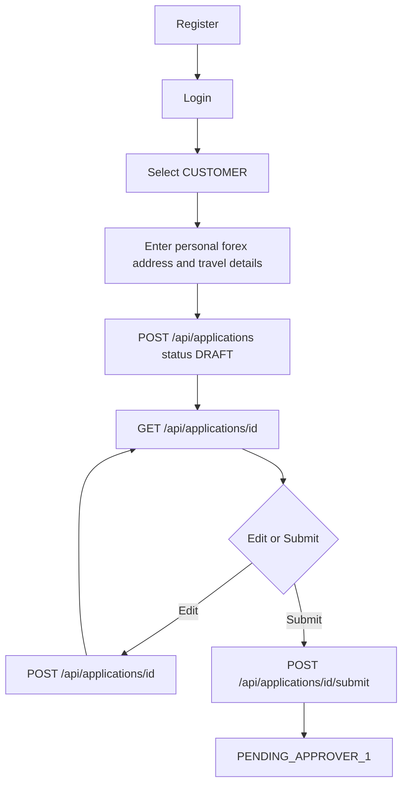
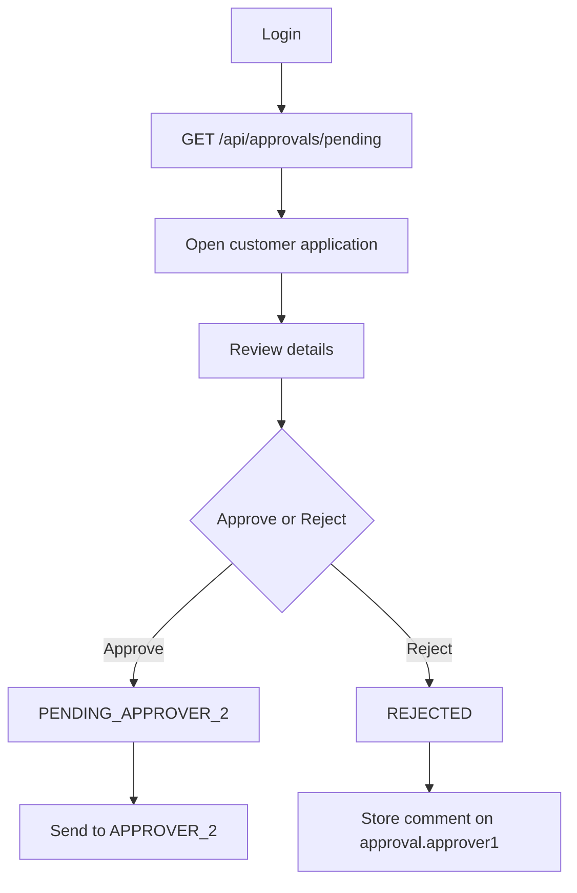
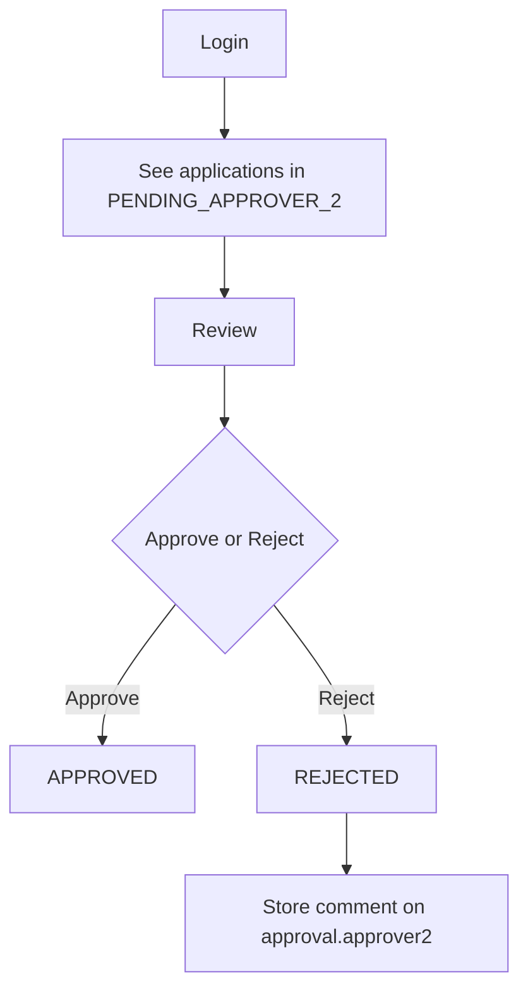
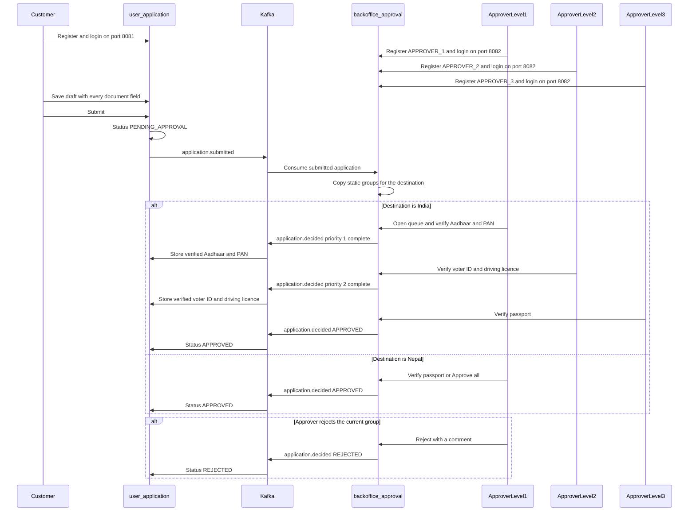

# Backoffice two-level approval backend

Fresh project. Do not extend the current Spring Boot basics app. Stack: Kotlin, Spring Boot, MongoDB, Spring Security, JWT.

Two collections: `users` and `applications`.

## Customer workflow

`POST /api/applications` saves the four sections as `DRAFT` and returns the application id. The next screen loads that id with GET. Edit is `POST /api/applications/{id}` with the same body. Submit calls `/submit` and sets `PENDING_APPROVER_1`. There is no PUT.



## Approver 1 workflow

`GET /api/approvals/pending` returns applications in `PENDING_APPROVER_1`. Approve and reject use the application id.



Approve writes `approval.approver1` (`userId`, `action`, `actionAt`) and sets status to `PENDING_APPROVER_2`. Reject sets status to `REJECTED` and stores the reason in `approval.approver1.comment`. A rejected application is not sent to Approver 2.

## Approver 2 workflow



Approver 2's pending list contains only `PENDING_APPROVER_2`. Approve sets status to `APPROVED` and fills `approval.approver2`. Reject sets `REJECTED` and stores the comment on `approval.approver2`.

## users

Role enum: `CUSTOMER`, `APPROVER_1`, `APPROVER_2`.

`password` is the BCrypt hash. Never store or return the plain password.

Customer:

```json
{
  "_id": "ObjectId",
  "email": "jay@example.com",
  "password": "$2a$10$...",
  "role": "CUSTOMER",
  "name": "Jaydip",
  "phone": "9876543210",
  "active": true,
  "createdAt": "2026-10-07T10:00:00Z",
  "updatedAt": "2026-10-07T10:00:00Z"
}
```

Approver (`phone` omitted):

```json
{
  "_id": "ObjectId",
  "email": "approver1@company.com",
  "password": "$2a$10$...",
  "role": "APPROVER_1",
  "name": "Approver One",
  "active": true,
  "createdAt": "2026-10-07T10:00:00Z",
  "updatedAt": "2026-10-07T10:00:00Z"
}
```

Unique index on `email`.

## applications

One application per customer. `customerId` is unique. The API still uses the application id, because GET, the update POST, submit, approve, and reject all target that document.

```json
{
  "_id": "ObjectId",
  "customerId": "ObjectId",
  "status": "DRAFT",
  "personalDetails": {
    "firstName": "Jaydip",
    "lastName": "Parmar",
    "dateOfBirth": "1998-01-01",
    "gender": "MALE",
    "panNumber": "ABCDE1234F",
    "email": "jay@example.com",
    "mobile": "9876543210"
  },
  "forexCardDetails": {
    "cardType": "MULTI_CURRENCY",
    "currency": "USD",
    "amount": 5000,
    "purpose": "TRAVEL"
  },
  "addressDetails": {
    "addressLine1": "ABC Street",
    "city": "Rajkot",
    "state": "Gujarat",
    "country": "India",
    "pincode": "360001"
  },
  "travelDetails": {
    "destinationCountry": "USA",
    "departureDate": "2026-12-01",
    "returnDate": "2026-12-15",
    "purpose": "BUSINESS"
  },
  "approval": {
    "approver1": {
      "userId": null,
      "action": null,
      "comment": null,
      "actionAt": null
    },
    "approver2": {
      "userId": null,
      "action": null,
      "comment": null,
      "actionAt": null
    }
  },
  "createdAt": "2026-10-07T10:00:00Z",
  "updatedAt": "2026-10-07T10:00:00Z"
}
```

`ApplicationStatus`:

- `DRAFT` — saved by POST, still editable with `POST /api/applications/{id}`
- `PENDING_APPROVER_1` — customer submitted; Approver 1 pending list
- `PENDING_APPROVER_2` — Approver 1 approved; Approver 2 pending list
- `APPROVED` — Approver 2 approved
- `REJECTED` — either approver rejected; the comment lives on that approver's block

Submit sets `PENDING_APPROVER_1`. The sample value `SUBMITTED` is not in this enum.

`POST /api/applications/{id}` is allowed while status is `DRAFT` or `REJECTED`. After `REJECTED`, that same call updates the application, and submit clears both approval blocks and sets `PENDING_APPROVER_1`.

Mask `panNumber` in the approver list (last 4 characters). The open-application GET can return the full value to the assigned approver.

## API

Auth, public:

- `POST /api/auth/register` body: `email`, `password`, `role`, `name`, optional `phone`
- `POST /api/auth/login` body: `email`, `password` returns `accessToken`

Customer, JWT required, role `CUSTOMER`. The customer can only read and change their own application.

- `POST /api/applications` creates `DRAFT` and returns the id
- `GET /api/applications/{id}` review screen, all four sections
- `POST /api/applications/{id}` edit, only in `DRAFT` or `REJECTED`. Same body as create. The id in the route is what makes this an update
- `POST /api/applications/{id}/submit` validates every section and sets `PENDING_APPROVER_1`

Approver, JWT required:

- `GET /api/approvals/pending` — Approver 1 receives `PENDING_APPROVER_1`; Approver 2 receives `PENDING_APPROVER_2`
- `POST /api/approvals/{id}/approve`
- `POST /api/approvals/{id}/reject` body: `comment`

`ApprovalService` is the only writer of `status` and `approval`. Approver 2 cannot approve an application still in `PENDING_APPROVER_1`.

## Country approval sequence

Customers register and sign in on port 8081. Approvers register and sign in on port 8082. Submitting copies the destination's document groups onto the review. Each completed group publishes `application.decided`. Nepal finishes after the passport group.

| Destination | Approver 1 | Approver 2 | Approver 3 |
|---|---|---|---|
| India | Aadhaar and PAN | Voter ID and driving licence | Passport |
| UK | Aadhaar and PAN | Passport | Voter ID and driving licence |
| US | Passport | Driving licence | Aadhaar and PAN |
| Nepal | Passport, then approved | — | — |



## How to start

1. New Kotlin Spring Boot Gradle project: Web, Spring Data MongoDB, Security, Validation. Java 17. Database name in `application.properties`.
2. `users` plus register and login. BCrypt password. JWT carries user id and role.
3. `applications` plus the customer create POST, GET, update POST with `{id}`, and submit routes.
4. Approver pending list, approve, and reject, with the status rules above.
